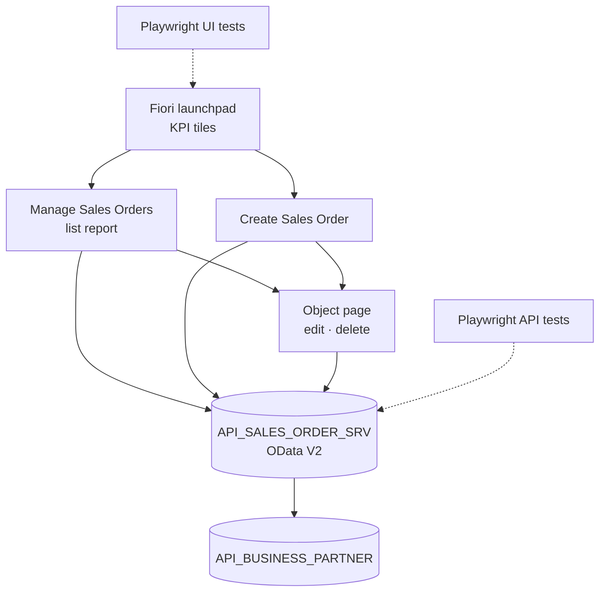

# Playwright × SAP S/4HANA Fiori

[](https://github.com/mukeshn/playwright-sap-fiori-s4hana/actions/workflows/playwright.yml)
[](https://mukeshn.github.io/playwright-sap-fiori-s4hana/)


[](LICENSE)

End-to-end tests for the order-to-cash entry point in S/4HANA: the Fiori launchpad, the **Manage Sales Orders** list report, the object page, **Create Sales Order**, and the `API_SALES_ORDER_SRV` OData V2 service underneath them.

The bundled SUT copies how the real system behaves: UI5-style stable IDs (`listReport--btnGo`), a busy indicator during OData calls, growing tables, value-help dialogs, the message popover, `x-csrf-token: Fetch` handling and SAP error payloads (`V1/302`, `sap-message` headers).

## Highlights

| Topic | Approach |
|---|---|
| **UI5 synchronisation** | `waitForUI5()` waits for pending OData requests to reach zero and for the busy indicator to disappear, the same idea wdi5 uses with the UI5 core |
| **Stable IDs** | only `<view>--<control>` ids, never generated `__xmlview3--…` ones |
| **Growing tables** | `loadAll()` clicks *More* until every row is loaded, then compares the count with `$inlinecount` |
| **Value help (F4)** | generic `chooseFromValueHelp()` |
| **Message popover** | backend `errordetails` checked including their `target` path |
| **CSRF** | API client fetches the token before any write, and UI tests check the browser does the same |
| **Session** | logon happens once per worker (worker-scoped fixture), and the SAP session cookie is shared |
| **UI ↔ backend consistency** | KPI tiles and list counts are compared with OData `$count` / `$inlinecount` |



## Run

```bash
npm ci
npx playwright test
npx playwright test --project=api      # OData only
npx playwright test --grep @smoke
```

<details>
<summary><b>OData scenarios covered</b></summary>

- Basic auth required (`401` + `WWW-Authenticate`)
- `$metadata` contains the entity sets and keys
- `$select`, `$top`/`$skip` paging, `$orderby`, `$filter` with `and`, `substringof()`
- `$expand=to_Item` vs. no expand
- Deep insert (header + items), `Location` and `sap-message` headers
- CSRF: `403 CSRF token validation failed` without token
- Business rules: completely processed orders are read-only, orders with follow-on documents can't be deleted
- PATCH of read-only property rejected
</details>

<details>
<summary><b>Moving to a real S/4HANA system</b></summary>

Set `BASE_URL` to the Fiori launchpad host, replace `S4_USER` with a technical test user (or SAML/IAS login in the worker fixture), and keep the UI5 ids, which match the standard apps' view ids. The OData client already speaks the standard `API_SALES_ORDER_SRV` contract.
</details>

---
See also: [sap-odata-api-tests](https://github.com/mukeshn/sap-odata-api-tests) · [selenium-sap-fiori-automation](https://github.com/mukeshn/selenium-sap-fiori-automation)
